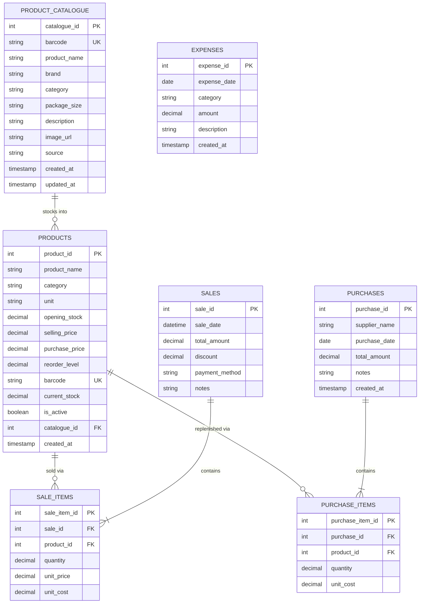

# AI Shopkeeper

> **An intelligent, voice-enabled assistant designed to empower small retail and kirana shopkeepers with barcode scanning, billing, inventory control, and grounded business insights.**

[](LICENSE)
[](https://www.python.org/)
[](https://flask.palletsprojects.com/)
[](https://www.mysql.com/)
[](https://ai.google.dev/gemma)

---

## Table of Contents

- [Project Overview](#project-overview)
- [Key Features](#key-features)
- [How It Works](#how-it-works)
- [Technology Stack](#technology-stack)
- [Project Structure](#project-structure)
- [Prerequisites](#prerequisites)
- [Installation and Setup](#installation-and-setup)
- [Environment Configuration](#environment-configuration)
- [Database Design](#database-design)
- [Running the Application](#running-the-application)
- [API Integration](#api-integration)
- [Security and Data Integrity](#security-and-data-integrity)
- [Troubleshooting](#troubleshooting)
- [Future Enhancements](#future-enhancements)
- [Contributing](#contributing)
- [License](#license)
- [Author](#author)

---

## Project Overview

### The Problem
Small retail businesses and traditional neighborhood *kirana* stores face significant operational challenges:
- **Manual Bookkeeping**: Many shopkeepers still rely on paper notebooks to record sales and credit, leading to arithmetic mistakes, lost entries, and time-consuming end-of-day tallying.
- **Blind Margins**: Shopkeepers often know their gross cash intake at the end of the day, but remain unaware of their true net profit after accounting for purchase costs (Cost of Goods Sold) and daily overhead expenses.
- **Expensive Hardware Barriers**: Conventional point-of-sale (POS) systems require dedicated barcode guns, thermal receipt printers, and costly ERP subscriptions that are out of reach for small vendors.
- **Language and Usability Hurdles**: Most retail software is designed in rigid English interfaces with steep learning curves, excluding regional language speakers who prefer intuitive voice interaction.

### The Solution
**AI Shopkeeper** bridges this gap by transforming an ordinary laptop running Windows 11 with standard hardware (integrated webcam, speakers, and microphone) into a complete, intelligent retail management system. 

It delivers:
1. **Camera-Based Barcode Scanning**: Instant barcode recognition directly through the device webcam or phone camera without requiring a physical barcode scanner.
2. **Fast POS Billing & Inventory Sync**: Atomic transaction processing that generates bills, updates stock in real time, and prints clean receipts.
3. **Automated Catalog Discovery**: Seamless 3-tier product lookup that automatically queries local inventory, a pre-cached catalogue, or international Open Product databases (Open Food Facts / Open Beauty Facts).
4. **Grounded AI Assistance via Gemma**: An AI business consultant powered by Google's Gemma model that answers financial, inventory, and retail strategy questions in **English**, **Telugu (తెలుగు)**, or **Hindi (हिंदी)**, with strict database grounding to prevent hallucination.
5. **Hands-Free Spoken Interaction**: Spoken verbal responses and speech-to-text input tailored for busy store environments.

### Intended Users
- Neighborhood kirana and grocery stores
- Independent general stores and FMCG retailers
- Small-scale stationeries, pharmacies, and specialty retailers
- Solo entrepreneurs seeking affordable, automated sales and inventory tracking

---

## Key Features

| Feature | Status | Description |
| :--- | :---: | :--- |
| **Webcam Barcode Scanning** | `Implemented` | Scans EAN-13, UPC-A, and Code-128 barcodes via laptop camera with client-side detection and `zxing-cpp` server fallback. |
| **3-Tier Product Lookup** | `Implemented` | Checks local inventory first, then local master catalogue, and falls back to online Open Food/Beauty Facts APIs. |
| **Quick Billing POS** | `Implemented` | Live bill generation, quantity adjustments, custom discounts, payment method selection (Cash, UPI, Card), and print receipts. |
| **Atomic Inventory Updates** | `Implemented` | Automatically decrements inventory counts inside MySQL ACID transactions upon checkout to prevent race conditions. |
| **Manual & Unbarcoded Goods Entry** | `Implemented` | Enables searching and adding non-barcoded goods (loose grains, produce) by product name or manual entry. |
| **Spoken Voice Output (TTS)** | `Implemented` | Browser-based Web Speech API synthesis that reads out chatbot answers and POS checkout confirmations aloud. |
| **Voice Input (STT)** | `Implemented` | Transcribes spoken queries via browser microphone in English, Telugu, and Hindi without heavy local speech models. |
| **Multilingual Support** | `Implemented` | Full bilingual/trilingual interaction (Telugu, Hindi, English) across Chatbot and Voice Assistant. |
| **Grounded AI Shop Assistant** | `Implemented` | Connects Google's `gemma-4-31b-it` to MySQL via `shop_analytics.py` to answer business questions without hallucinating. |
| **Financial & P&L Analytics** | `Implemented` | Calculates Daily, Weekly, Monthly, and Custom revenue, Cost of Goods Sold (COGS), Gross Profit, Expenses, and Net Profit. |
| **Bulk Catalogue Importer** | `Implemented` | CLI importer for Indian kirana CSV/JSONL datasets with barcode validation, deduplication, and safe batch inserts. |
| **Stock Alerts & Reorder Tracking** | `Implemented` | Visual badges for Low Stock (below reorder threshold) and Out of Stock products. |
| **Role-Based User Authentication** | `Planned` | Multi-user cashier vs. manager authentication and permission management. |
| **Direct ESC/POS Thermal Printing** | `Planned` | Native hardware communication with USB/Bluetooth thermal receipt printers. |
| **WhatsApp / SMS Receipt Dispatch** | `Planned` | Automated digital invoice dispatch to customer phone numbers. |
| **Offline Embedded Speech Models** | `Planned` | Lightweight local Vosk/Whisper-tiny fallback for environments without internet access. |

---

## How It Works

### High-Level Architecture & Workflow

```mermaid
flowchart TD
    subgraph POS_and_Inventory["Point of Sale & Inventory"]
        A["Product Scanned / Entered"] --> B{"Exists in Inventory?"}
        B -- Yes --> C["Fetch Price & Available Stock"]
        B -- No --> D{"Found in Catalogue?"}
        D -- Yes --> E["Display Catalogue Info"]
        D -- No --> F["Query Open Food / Beauty Facts"]
        F -- Found --> G["Cache in product_catalogue"]
        F -- Not Found --> H["Manual Product Registration"]
        E --> I["Stock Product: Set Price & Qty"]
        G --> I
        H --> I
        I --> C
        C --> J["Add Line Item to Cart"]
        J --> K["Apply Discount & Select Payment"]
        K --> L["Confirm Sale / Checkout"]
        L --> M["Insert into `sales` & `sale_items`"]
        M --> N["Atomically Decrement `products.current_stock`"]
        N --> O["Print Receipt & Speak Spoken Confirmation"]
    end

    subgraph AI_Intelligence["Grounded AI Intelligence"]
        P["Shopkeeper Voice or Text Query"] --> Q["Voice Assistant / Chatbot"]
        Q --> R["Fetch Real Business Metrics (`shop_analytics.py`)"]
        R --> S["MySQL Database (`shopkeeper_ai`)"]
        S --> R
        R --> T["Build Grounded Context Payload"]
        T --> U["Google Gemma API (`gemma-4-31b-it`)"]
        U --> V["Synthesize Natural Response"]
        V --> W["Display Response in UI"]
        V --> X["Speak Answer Aloud via Web Speech API"]
    end
```



### The Workflow in Detail
1. **Product Identification**: When a product barcode is scanned through the webcam or entered manually, the application checks `products`. If missing, it queries `product_catalogue`. If still missing, it makes a lightweight HTTP request to Open Food Facts / Open Beauty Facts.
2. **Inventory Addition**: Once an unknown item is identified online, the shopkeeper can stock it into their local inventory by providing their selling price, purchase cost, initial stock quantity, and reorder level.
3. **Transaction Execution**: The shopkeeper adds items to the cart, applies optional discounts, chooses a payment method (Cash, UPI, or Card), and confirms the sale.
4. **ACID Transaction**: A MySQL transaction writes the sale header into `sales`, writes all line items into `sale_items`, and atomically decrements `products.current_stock`. If any operation fails, the entire transaction rolls back.
5. **AI Consultation**: When the shopkeeper asks a question (e.g., *"How much profit did I make today?"* or *"ఏ వస్తువులు తక్కువ స్టాక్‌లో ఉన్నాయి?"*), the backend executes predefined SQL aggregation queries in `shop_analytics.py`, formats the real numbers into a JSON context, and instructs Gemma to explain the data conversationally in the user's language without inventing numbers.

---

## Technology Stack

| Layer | Technology | Purpose in Project |
| :--- | :--- | :--- |
| **Backend Framework** | [Python 3.10+](https://www.python.org/) & [Flask 3.1](https://flask.palletsprojects.com/) | RESTful API server, routing, transaction coordination, and business logic execution. |
| **Database** | [MySQL](https://www.mysql.com/) / [MariaDB](https://mariadb.org/) (via XAMPP) | Relational storage for inventory, master catalogue, sales, purchases, and operating expenses. |
| **Database Driver** | `mysql-connector-python` | Thread-safe, parameterized database connection and transaction handling. |
| **AI / Large Language Model** | [Google GenAI SDK](https://github.com/googleapis/python-genai) (`gemma-4-31b-it`) | High-reasoning multilingual generative model for retail advice and grounded business queries. |
| **Computer Vision** | [OpenCV](https://opencv.org/) (`opencv-python`) & [zxing-cpp](https://github.com/zxing-cpp/zxing-cpp) | High-performance 1D/2D barcode localization, frame contrast cropping, and decoding. |
| **Client-Side Scanner** | HTML5 Canvas & Web API `BarcodeDetector` | Ultra-fast native browser camera decoding with zero server round-trip latency when supported. |
| **Speech Processing** | Browser Web Speech API (`SpeechRecognition` & `SpeechSynthesis`) | Zero-footprint speech-to-text and text-to-speech running locally in the browser without GPU overhead. |
| **External Product APIs** | [Open Food Facts](https://world.openfoodfacts.org/) & Open Beauty Facts | Global crowdsourced product databases queried on-demand for nutritional, brand, and packaging data. |
| **Data Processing** | [Pandas](https://pandas.pydata.org/) & [Pillow](https://python-pillow.org/) | Bulk CSV catalogue parsing, dataset cleaning, and test barcode image processing. |
| **Frontend** | Vanilla HTML5, CSS3, JavaScript (ES6+) | Lightweight, responsive single-page dashboard designed for fast loading on 8 GB RAM laptops. |

---

## Project Structure

```
ai_shopkeeper/
│
├── static/
│   ├── css/
│   │   └── style.css                 # Responsive layout, dark accents, laser scan guides, and badges
│   └── js/
│       ├── app.js                    # Web dashboard controller, POS cart, camera modal, API clients
│       └── voice.js                  # Speech recognition, speech synthesis, and audio beep synthesis
│
├── templates/
│   └── index.html                    # Single-page web dashboard (POS, Lookup, Inventory, Reports, Chatbot)
│
├── billing_system.py                 # Core transactional billing logic and stock decrement operations
├── catalogue_importer.py             # CLI bulk importer for Indian kirana CSV/JSONL master catalogues
├── chatbot.py                        # Gemma AI integration with strict database grounding and safety guardrails
├── daily_report.py                   # Terminal-based daily financial P&L reporting utility
├── gui_billing.py                    # Standalone desktop Tkinter GUI billing interface
├── product_lookup_service.py         # 3-tier product lookup service (Inventory -> Catalogue -> Online APIs)
├── shop_analytics.py                 # Financial metrics engine (Revenue, COGS, Gross/Net Profit, Stock alerts)
├── voice_assistant.py                # Voice query processing, intent detection, and spoken response generation
├── web_app.py                        # Flask web application entry point and REST API route handlers
├── webcam_scanner.py                 # Standalone OpenCV / zxing-cpp desktop camera barcode scanner
│
├── curated_indian_kirana_sample.csv  # Verified sample catalogue of common Indian retail items
├── daily_goods_full_sample_dataset.csv # Extended grocery and daily-goods reference dataset
│
├── schema.sql                        # Complete MySQL database schema creation script
├── requirements.txt                  # Python package dependencies
├── .env.example                      # Safe environment variable template
├── .gitignore                        # Git exclusion rules for secrets, caches, and environments
└── LICENSE                           # Official Apache License 2.0 text
```

---

## Prerequisites

Before setting up AI Shopkeeper, ensure your system meets the following requirements:

1. **Operating System**: Windows 10 or Windows 11 (64-bit).
2. **RAM & Hardware**: Minimum 8 GB RAM; standard dual-core CPU; integrated webcam and microphone.
3. **Python**: Python 3.10, 3.11, or 3.12 (check with `python --version`).
4. **MySQL Database Server**: 
   - [XAMPP](https://www.apachefriends.org/) (recommended for Windows) with MySQL/MariaDB and Apache enabled, OR
   - Standalone MySQL Server 8.0+.
5. **Modern Web Browser**: Google Chrome or Microsoft Edge (recommended for native `BarcodeDetector` and Web Speech API support).
6. **Google AI Studio API Key**: Required for the Gemma chatbot ([Get a free key here](https://aistudio.google.com/)).

---

## Installation and Setup

Follow these step-by-step instructions in Windows PowerShell or Command Prompt.

### Step 1: Clone the Repository
```powershell
git clone https://github.com/[YOUR_USERNAME]/ai_shopkeeper.git
cd ai_shopkeeper
```

### Step 2: Create and Activate a Python Virtual Environment
```powershell
# Create virtual environment named 'venv'
python -m venv venv

# Activate on Windows PowerShell:
.\venv\Scripts\Activate.ps1

# (Or on Windows Command Prompt:)
# .\venv\Scripts\activate.bat
```

> *Tip: If PowerShell blocks script execution, run `Set-ExecutionPolicy -ExecutionPolicy RemoteSigned -Scope CurrentUser` once.*

### Step 3: Install Required Dependencies
```powershell
python -m pip install --upgrade pip
pip install -r requirements.txt
```

### Step 4: Start MySQL and Set Up the Database

1. Open the **XAMPP Control Panel** and click **Start** next to **MySQL** (and **Apache** if using phpMyAdmin).
2. Create the database schema using either of the following methods:

**Method A: Using MySQL Command Line**
```powershell
mysql -u root -p -e "CREATE DATABASE IF NOT EXISTS shopkeeper_ai;"
mysql -u root -p shopkeeper_ai < schema.sql
```

**Method B: Using phpMyAdmin**
1. Navigate to `http://localhost/phpmyadmin/` in your browser.
2. Click **Import** in the top navigation bar.
3. Choose the `schema.sql` file from the project directory.
4. Click **Go** to execute the script.

### Step 5: Configure Environment Variables
Copy the `.env.example` template to `.env`:
```powershell
Copy-Item .env.example .env
```
Open `.env` in Notepad or VS Code and enter your actual credentials:
```env
GEMINI_API_KEY=your_actual_google_genai_api_key
DB_HOST=localhost
DB_PORT=3306
DB_USER=root
DB_PASSWORD=
DB_NAME=shopkeeper_ai
PORT=5000
```

### Step 6 (Optional): Import Initial Kirana Catalogue
Populate your general master catalogue with over 60 common Indian grocery items:
```powershell
python catalogue_importer.py --file curated_indian_kirana_sample.csv
```
Follow the interactive prompt to confirm the batch insert.

### Step 7: Verify Database Connectivity
```powershell
python test_database.py
```
You should see:
```text
Database connected successfully!
Tables in shopkeeper database:
- expenses
- product_catalogue
- products
- purchase_items
- purchases
- sale_items
- sales
```

---

## Environment Configuration

The application reads configuration parameters from a `.env` file located in the root directory.

| Variable Name | Required | Default Value | Description |
| :--- | :---: | :---: | :--- |
| `GEMINI_API_KEY` | **Yes** | *None* | Google GenAI API key for accessing `gemma-4-31b-it`. |
| `DB_HOST` | No | `localhost` | Hostname or IP address of the MySQL database server. |
| `DB_PORT` | No | `3306` | Port number of the MySQL server. |
| `DB_USER` | No | `root` | Database username with read/write privileges on `shopkeeper_ai`. |
| `DB_PASSWORD` | No | `""` (empty) | Password for the MySQL user. |
| `DB_NAME` | No | `shopkeeper_ai` | Name of the shop database. |
| `PORT` | No | `5000` | Local TCP port for the Flask web application. |

> **IMPORTANT**: Never commit your real `.env` file to GitHub. The repository includes `.env` in `.gitignore` to protect your credentials.

---

## Database Design

The database schema is organized around retail sales, inventory tracking, catalogue caching, and financial reporting.



### Table Descriptions
- **`product_catalogue`**: Global master product information. Holds cached barcodes, brand names, and package sizes from Open Food Facts or CSV imports. Does not contain shop-specific prices.
- **`products`**: The shop's active inventory. Stores local selling prices, purchase costs, current on-hand stock quantities, and minimum reorder thresholds.
- **`sales`**: Header records for every checkout transaction, including total revenue, discount applied, timestamp, and payment method (`cash`, `upi`, `card`).
- **`sale_items`**: Line items for each completed sale. Captures both `unit_price` (selling price) and `unit_cost` (purchase price at sale time) to enable exact historical profit calculations even if prices change later.
- **`expenses`**: Operating shop expenses (electricity, rent, packaging, transport) factored into Net Profit calculations.
- **`purchases` & `purchase_items`**: Supplier inventory replenishment headers and line items.

---

## Running the Application

### 1. Launch the Main Web Dashboard
Ensure your virtual environment is active and run:
```powershell
python web_app.py
```
Open your web browser and navigate to:
```
http://127.0.0.1:5000
```

### 2. Available Application Views & Workflows

- **Dashboard**: View high-level business KPIs (Today's Sales, Net Profit, Transaction Count, Low Stock Alerts).
- **Quick Billing (POS)**:
  1. Click **`📷 Camera Scan`** to open the webcam scanner modal, or type a barcode / product name into the search bar.
  2. The scanned product is added to the active bill with a sound beep.
  3. Adjust quantities or apply a discount if needed.
  4. Select payment method (**Cash**, **UPI**, or **Card**).
  5. Click **Complete Sale**. The system updates stock, prints a receipt, and speaks the confirmation aloud.
- **Product Lookup**:
  1. Scan any barcode.
  2. If the product is not currently stocked in your store, the system searches the master catalogue and online APIs.
  3. Click **Add to My Shop** to enter your selling price, purchase cost, and initial stock.
- **Inventory Management**:
  1. Monitor active stock levels and reorder warnings.
  2. Add new products manually (for items without barcodes like loose rice, sugar, or vegetables).
  3. Update stock levels on existing products.
- **Sales & Reports**:
  1. View profit & loss statements filtered by period: Today, Yesterday, This Week, This Month, or Custom Date Range.
  2. Review historical sales logs and itemized sale details.
- **AI Assistant & Voice Assistant**:
  1. Click the **🎙️ Microphone** button and ask any business question (e.g., *"What is my net profit today?"*, *"ఈరోజు ఎంత అమ్మకాలు జరిగాయి?"*, or *"Which products are low in stock?"*).
  2. The chatbot replies with verified database numbers and speaks the answer aloud.

### 3. Alternative Terminal & Desktop Tools
- **Terminal Daily Report**: Run `python daily_report.py` for a quick CLI financial summary.
- **Standalone Desktop GUI**: Run `python gui_billing.py` for a Tkinter desktop checkout window.
- **Desktop Camera Scanner**: Run `python webcam_scanner.py` to test standalone camera barcode decoding.

---

## API Integration

### Google Gemma Integration
AI Shopkeeper utilizes the official **Google GenAI SDK** (`from google import genai`) targeting the `gemma-4-31b-it` (or fallback `gemma-4-26b-a4b-it`) model via the `v1beta` endpoint.

#### Grounding Architecture
To prevent the language model from hallucinating sales figures, pricing, or stock counts, the application employs a **Database-First Grounding Pattern**:
1. When a user asks a question, `chatbot.py` analyzes the intent (e.g., profit inquiry, stock alert, product price check).
2. The backend executes verified SQL aggregation queries using `shop_analytics.py` and `billing_system.py`.
3. The exact numerical results are injected into the model's system prompt as a structured context payload.
4. Gemma is strictly instructed:
   > *"You must only cite the exact figures provided in the business context. If the database reports zero or no matching records, state that clearly. Never guess or invent missing numbers."*

### Online Product APIs
When an unrecognised barcode is scanned, `product_lookup_service.py` safely queries public product databases:
- **Open Food Facts**: `https://world.openfoodfacts.org/api/v2/product/{barcode}.json`
- **Open Beauty Facts**: `https://world.openbeautyfacts.org/api/v2/product/{barcode}.json`
- **Open Products Facts**: `https://world.openproductsfacts.org/api/v2/product/{barcode}.json`

All requests enforce a strict 6-second timeout, request only necessary product metadata, respect public rate limits, and automatically cache successful responses in `product_catalogue`.

---

## Security and Data Integrity

### Credential Safety
- All database passwords and API keys are loaded via `python-dotenv` from `.env`.
- The `.gitignore` file prevents accidental commits of secrets, virtual environments, and cache directories.

### Transactional Consistency (ACID)
- Every checkout operation in `billing_system.py` uses explicit MySQL transactions (`connection.start_transaction()`).
- Both sale record insertion and stock decrement operations must succeed together. If any item is out of stock or database connectivity drops, `connection.rollback()` is executed, preventing phantom sales or stock drift.

### Parameterized Queries
- All database queries across the project use parameterized placeholders (`%s`) to completely eliminate SQL injection vulnerabilities.

### Security Status: Local Development vs. Production
- **Current Status**: AI Shopkeeper is currently designed as a single-user local application intended to run on the shopkeeper's personal laptop (`http://127.0.0.1:5000`).
- **Recommended Production Hardening**:
  - Deploying behind a reverse proxy (e.g., NGINX) with TLS/HTTPS encryption.
  - Adding user authentication (password hashing with bcrypt and session/JWT tokens) to separate cashier and manager roles.
  - Enforcing strict CORS policies and CSRF protection tokens on all POST endpoints.

---

## Troubleshooting

### 1. Database Connection Errors
* **Error**: `mysql.connector.errors.ProgrammingError: 1049 (42000): Unknown database 'shopkeeper_ai'`
  * **Solution**: Ensure you created the database and imported `schema.sql`. Run `mysql -u root -p -e "CREATE DATABASE shopkeeper_ai;"` followed by `mysql -u root -p shopkeeper_ai < schema.sql`.
* **Error**: `mysql.connector.errors.InterfaceError: 2003: Can't connect to MySQL server on 'localhost'`
  * **Solution**: Ensure MySQL is running in the XAMPP Control Panel. Check if your MySQL server is running on a custom port (e.g., 3307) and update `DB_PORT` in your `.env`.

### 2. Gemma API Errors
* **Error**: `google.genai.errors.APIError: 403 / 400 Invalid API Key`
  * **Solution**: Verify that `GEMINI_API_KEY` in `.env` is set to a valid key from [Google AI Studio](https://aistudio.google.com/). Ensure there are no surrounding quotes or extra spaces.
* **Error**: `Sorry, the Gemma API is currently experiencing high demand.`
  * **Solution**: The Google GenAI beta endpoint occasionally hits temporary rate limits. The system catches these errors gracefully. Wait a few seconds and retry.

### 3. Camera Barcode Scanning Issues
* **Issue**: The webcam scanner modal shows a black screen or permission prompt fails.
  * **Solution**: In Chrome/Edge, click the padlock/settings icon in the URL bar (`http://127.0.0.1:5000`) and grant **Camera** access. Ensure no other application (Zoom, Teams, Camera app) is holding the webcam lock.
* **Issue**: The camera struggles to focus on small barcodes.
  * **Solution**: Hold the product 6 to 10 inches away from the lens under adequate lighting. The red laser line indicates the optimal detection band.

### 4. Voice Input / Output Issues
* **Issue**: Microphone button does not transcribe speech.
  * **Solution**: Grant **Microphone** permission in your browser. Note that browser-based speech recognition requires an active internet connection to communicate with browser speech endpoints.
* **Issue**: Spoken audio does not play automatically.
  * **Solution**: Modern browsers block audio autoplay until the user interacts with the page. Click anywhere on the dashboard or click the **`👋 Speak Greeting`** button to unlock browser audio playback.

---

## Future Enhancements

The following features represent genuine planned work for upcoming releases:
- [ ] **Multi-User Role-Based Access Control (RBAC)**: Cashier, Manager, and Store Owner login roles.
- [ ] **Direct Thermal Receipt Printing**: Direct integration with USB and Bluetooth 58mm/80mm ESC/POS thermal printers.
- [ ] **Digital Invoicing**: Automated WhatsApp and SMS receipt delivery to customer phone numbers.
- [ ] **Barcode Label Printing**: Printable sticker generator for unbarcoded or repacked bulk goods.
- [ ] **Offline Speech Models**: Integrated lightweight speech recognition (Vosk / Whisper-tiny) for environments with no internet access.
- [ ] **Supplier Order Management UI**: Frontend screens for tracking supplier purchase orders and stock receipts using the existing `purchases` and `purchase_items` schema.
- [ ] **Cloud Backup & Synchronization**: Multi-branch support and encrypted cloud database backups.

---

## Contributing

Contributions from the developer and retail technology communities are welcome! To contribute:

1. **Fork the Repository** on GitHub.
2. **Create a Feature Branch**:
   ```powershell
   git checkout -b feature/your-feature-name
   ```
3. **Write and Test Your Changes**:
   Ensure all tests pass before opening a pull request:
   ```powershell
   python test_database.py
   python test_web_api.py
   python test_voice_assistant.py
   python test_product_lookup_service.py
   ```
4. **Commit Your Changes**:
   ```powershell
   git commit -m "Add: Descriptive feature title"
   ```
5. **Push to Your Branch**:
   ```powershell
   git push origin feature/your-feature-name
   ```
6. **Open a Pull Request** describing your changes, testing methodology, and any UI impact.

---

## License

This project is licensed under the **Apache License 2.0**.

See the full license terms in the [LICENSE](LICENSE) file.

```text
Copyright 2026 Shaik Reshma

Licensed under the Apache License, Version 2.0 (the "License");
you may not use this file except in compliance with the License.
You may obtain a copy of the License at

    http://www.apache.org/licenses/LICENSE-2.0

Unless required by applicable law or agreed to in writing, software
distributed under the License is distributed on an "AS IS" BASIS,
WITHOUT WARRANTIES OR CONDITIONS OF ANY KIND, either express or implied.
See the License for the specific language governing permissions and
limitations under the License.
```

---

## Author

Developed by **Shaik Reshma**  
* Email: [reshmashaik9193@gmail.com](mailto:reshmashaik9193@gmail.com)  
* GitHub: [@your-github-username](https://github.com/your-github-username)  
* Project Repository: [https://github.com/your-github-username/ai_shopkeeper](https://github.com/your-github-username/ai_shopkeeper)

*(Please update the GitHub username placeholder with your actual GitHub handle once your repository is created.)*
